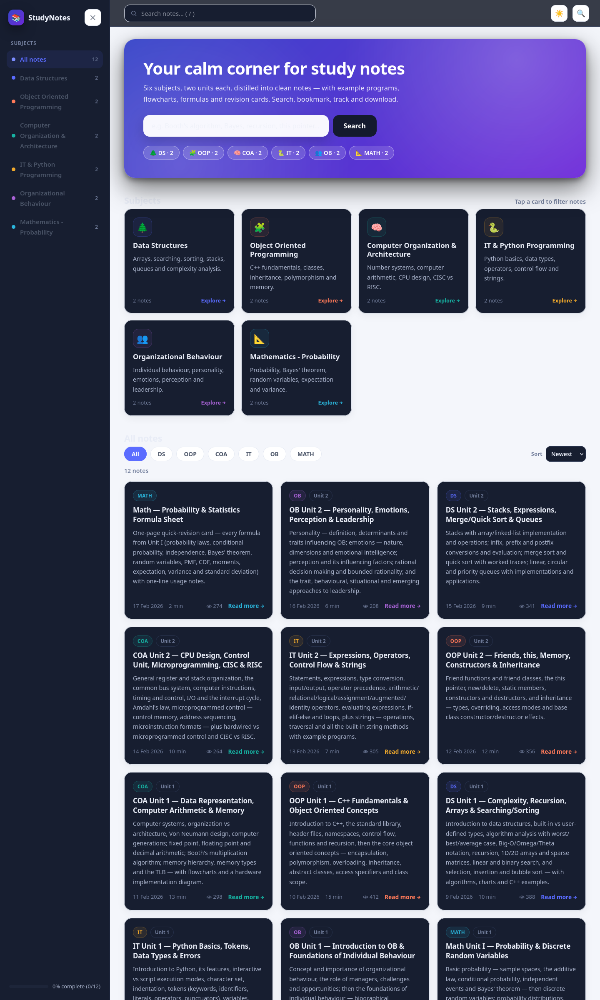
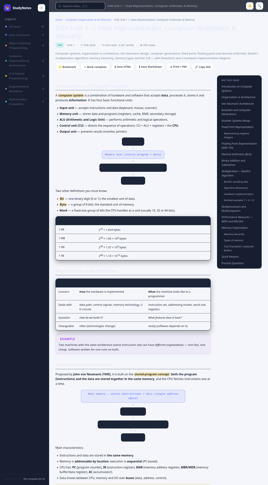
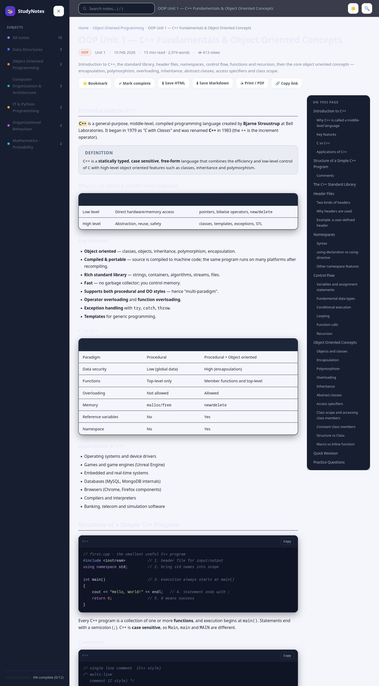
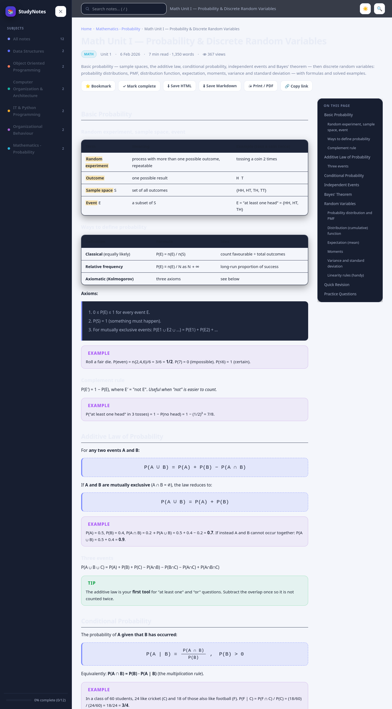

# 📚 StudyNotes

A stylish, modern, fully **offline-capable** study-notes website for 6 subjects —
**Data Structures, OOP (C++), COA, IT (Python), OB and Mathematics** — each with
rich notes covering the two units of the syllabus, plus a Math formula sheet.

Built with plain **HTML, CSS, JavaScript and real SQLite** (via
[sql.js](https://sql.js.org/), the WebAssembly build of SQLite running in the
browser). No frameworks, no build step, no CDN at runtime.


---

## 🖼 Preview

Real screenshots captured from the running site (in `preview/`):

| Home | Note · diagrams & tables |
|---|---|
|  |  |

| Note · syntax-highlighted code | Note · CSS-rendered formulas |
|---|---|
|  |  |

---

## ✨ Features

| Feature | Where |
|---|---|
| Homepage with hero, **featured** notes, **search bar** and **subject categories** | `index.html` |
| **Recently added**, **popular** and **recently viewed** sections | `index.html` |
| Card-based notes with subject colours, reading time, views and hover animations | every grid |
| Per-note **detail pages**: headings, bullet lists, `==highlighted keywords==`, TOC, prev/next, related notes | `note.html` |
| **Copy code** buttons + a small **C++/Python/SQL syntax highlighter** | note body |
| **Dark mode** toggle remembered in `localStorage` (auto-detects OS preference) | topbar 🌙 |
| **Bookmarks ⭐**, **recently viewed**, and a per-note **complete ✓** tracker with an overall progress bar | all pages |
| **Search overlay** — `/` or `Ctrl+K`, live results, ↑↓ / Enter navigation | all pages |
| **Download** each note as standalone **HTML** or **Markdown**; **Print / PDF** | note page |
| Math/chemistry-style formulas rendered with **pure HTML/CSS** (inline fractions) — no MathJax | math notes |
| Flowcharts, hardware diagrams and register layouts drawn with CSS (`flow`, `hw`, `fields`) | COA/DS notes |
| **Truly offline**: vendor files are local; works over `file://` too | assets/js/vendor |

---

## 🚀 Quick start

### Option A — with the real SQLite database (recommended)

sql.js makes genuine SQL queries in the browser, but fetching the `.wasm` and
`.db` files requires HTTP (browsers block those under `file://`):

```bash
cd StudyNotes
python3 serve.py            # → http://localhost:8000
```

Open <http://localhost:8000> in any browser.

### Option B — double-click `index.html`

Everything still works — the app automatically falls back to the embedded
`window.NOTES_DATA` dataset (same content, still searched/filtered/sorted in JS).
Only the "genuine SQL mode" is lost.

You can also force fallback mode over HTTP by appending `?fallback` to any URL
(e.g. `http://localhost:8000/index.html?fallback`) — handy for testing or on
browsers that block WebAssembly.

---

## 🗂 How it works

```
content/<subject>/*.md     ← markdown-subset sources (front-matter + notes)
        │
        ▼  python3 tools/build.py
        │
   ┌────┴────────┬───────────────────┐
data/notes.db    assets/js/notes-data.js
(real SQLite:    (embedded fallback;
 subjects, notes, window.NOTES_DATA,
 indexes, seeds) used under file://)
```

- `tools/build.py` parses the markdown-subset and writes **both** outputs.
  Parser supports: headings (with anchor ids), nested lists, tables, fenced
  code blocks (with copy-button wrapper), `> [!NOTE|TIP|WARNING|EXAMPLE|FORMULA|DEFINITION]`
  callouts, `==highlight==` keywords, **bold/italics/code/links** and raw-HTML
  passthrough (used for flowcharts, hardware boxes, formulas).
- `assets/js/db.js` — data layer. Tries sql.js first
  (`SELECT ... JOIN subjects ... WHERE ...` with real parameters); falls back to
  the embedded dataset. View counts are seeded in the DB and user **deltas** are
  folded back on every load, so `ORDER BY views` (Popular) stays authoritative.
- `assets/js/app.js` — rendering, search, theme, bookmarks, progress, downloads,
  code highlighting.
- `assets/css/style.css` — full design system (light/dark, layout, cards,
  callouts, code, tables, CSS math, diagrams, print).

### Rebuild after editing content

```bash
cd StudyNotes
python3 tools/build.py
```

---

## 🗒 Notes included (12)

| Subject | Unit 1 | Unit 2 |
|---|---|---|
| **OOP (C++)** | C++ fundamentals, namespaces, control flow, recursion, OOP concepts | Friends, `this`, `new/delete`, static, constructors/destructors, inheritance |
| **COA** | Data representation, Booth's algorithm, memory hierarchy, TLB, MIPS/MFLOPS | CPU/register/stack org, common bus, interrupts, Amdahl, microprogramming, CISC vs RISC |
| **DS** | Complexity (Big-O/Ω/Θ), recursion, arrays, sparse matrices, search, selection/insertion/bubble sort | Stacks, infix/prefix/postfix, merge/quick sort, linear/circular/priority queues |
| **IT (Python)** | Basics, tokens, data types, errors | Expressions, operators/precedence, control flow, strings & methods |
| **OB** | Concept & importance, managers, challenges, biographical characteristics, abilities, values, attitudes, diversity | Personality (Big Five), emotions & EI, perception & decisions, leadership approaches |
| **Math** | Probability & discrete random variables (with CSS-rendered formulas) | — plus a **formula sheet** card |

---

## 🧰 Requirements

- **Python 3** (≥ 3.8) with the standard library — only needed for `serve.py`
  and `tools/build.py` (uses the built-in `sqlite3` module).
- Any modern browser (Chromium, Firefox, Safari, Edge).

No internet, no Node, no npm, no pip packages required.

---

## 📁 Project layout

```
StudyNotes/
├── index.html              # homepage: hero, search, subjects, browse, featured,
│                           #          recently added, popular rail, your library
├── note.html               # note detail: TOC, actions, downloads, pager, related
├── serve.py                # zero-dependency local server (enables SQL mode)
├── content/                # markdown-subset sources, one file per unit
│   ├── oop/  coa/  ds/  it/  ob/  math/
├── tools/build.py          # content → notes.db + notes-data.js
├── data/notes.db           # real SQLite database (rebuilt by build.py)
└── assets/
    ├── css/style.css
    └── js/
        ├── app.js          # UI logic
        ├── db.js           # SQL + fallback data layer
        ├── notes-data.js   # embedded fallback dataset
        └── vendor/         # sql.js 1.10.3 (local, offline)
            ├── sql-wasm.js
            └── sql-wasm.wasm
```

---

## 🧪 Validation

Run the built-in self-check (rebuild + DB sanity + HTML tag balance):

```bash
cd StudyNotes && python3 tools/build.py
```

Then eyeball the page at `http://localhost:8000`:

- [ ] Cards render with subject colours; hover lifts them
- [ ] `/` and `Ctrl+K` open live search navigation with ↑↓/Enter
- [ ] Theme toggle persists across reloads
- [ ] Bookmark, mark-complete and progress bar persist in `localStorage`
- [ ] A note page shows TOC + scrollspy, copy-code, downloads, prev/next
- [ ] Open `index.html` directly (file://) → content still appears (fallback mode)

---

Made with 💜 for students. Print-ready, offline-ready, exam-ready.